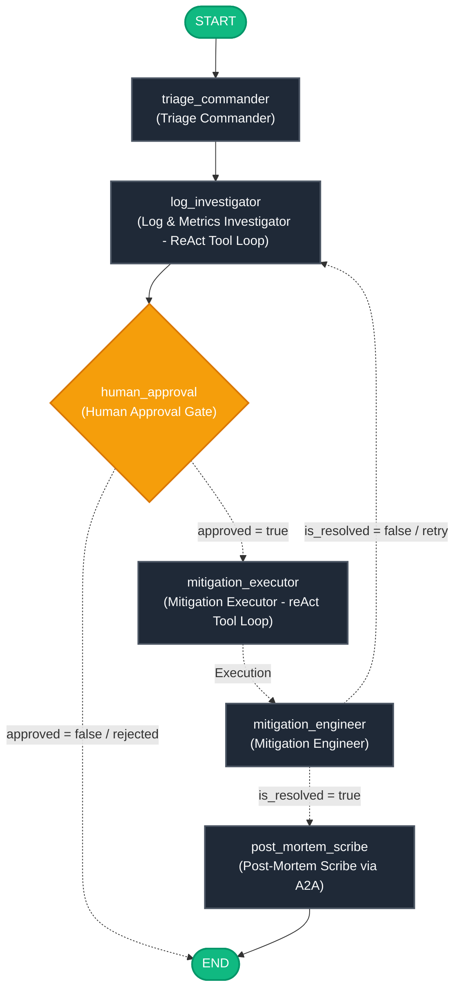
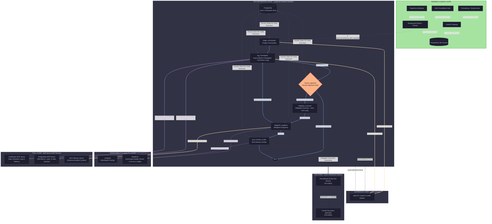

# Automated Infrastructure and Post-Mortem Engine

An AI-assisted incident-response service that accepts monitoring alerts, investigates them with
local language models and infrastructure tools, pauses for a human decision, and executes only
approved mitigation steps. FastAPI provides the ingress and approval API, PostgreSQL provides both
the durable work queue and LangGraph checkpoints, and a separate worker runs the incident workflow.

The project is designed to shorten the slow, repetitive part of incident response without removing
human control from potentially destructive actions. It turns unstructured alert payloads into a
consistent incident state, gathers evidence through MCP tools, proposes a mitigation, records an
approval decision, executes the approved plan, and verifies recovery with read-only checks.

> [!IMPORTANT]
> This is an experimental operations tool, not a replacement for production change controls.
> Review the MCP tools and their credentials, restrict their permissions, and test every mitigation
> in a non-production environment before granting access to live infrastructure.

## What problem it solves

Incident response often requires an operator to correlate a noisy alert with application logs and
database state, decide on a safe action, perform it, and then prove that the service recovered. That
process is time-sensitive, difficult to standardize, and prone to losing context between tools and
people. This engine provides one durable workflow for those steps:

- normalizes arbitrary webhook payloads into a structured incident record;
- uses tool-calling agents to gather evidence and identify a likely root cause;
- persists graph state so an incident can safely pause for human approval;
- separates read-only investigation and verification from mutation-capable execution;
- resumes approved or rejected incidents through a PostgreSQL-backed queue; and
- optionally sends LangGraph and model traces to Langfuse.

## Current implementation status

The checked-in workflow implements alert ingestion, triage, MCP-assisted investigation, a human
approval interrupt, approved mitigation execution, and read-only recovery verification. The
post-mortem scribe and external A2A/CrewAI handoff shown in the architecture diagrams are planned but
are currently commented out in `src/graph/workflow.py`; a successfully verified incident presently
ends the graph. The diagrams below are retained as the project workflow and target architecture.

## Contents

- [Workflow](#the-langgraph-flow)
- [System architecture](#the-complete-system-architecture)
- [How the system works](#how-the-system-works)
- [Technology stack](#technology-stack)
- [Local development](#local-development)
- [API reference](#api-reference)
- [Deployment](#deployment)
- [Testing and code quality](#testing-and-code-quality)
- [Operations and troubleshooting](#operations-and-troubleshooting)

---

## The LangGraph Flow


---
## The Complete System Architecture



## How the system works

1. A monitoring system sends a JSON payload to `POST /webhook/alerts`.
2. The API assigns a UUID session ID and stores the payload as a `pending` queue row.
3. The worker atomically claims the oldest eligible row with `FOR UPDATE SKIP LOCKED` and marks it
   `processing`. Up to three jobs can run concurrently in one worker process.
4. The triage agent extracts the service, severity, timestamp, and error summary through LiteLLM.
5. The investigator queries the configured MySQL and Elasticsearch MCP servers, rejects mutating
   investigation calls, and synthesizes a root cause and mitigation plan.
6. LangGraph checkpoints the state in PostgreSQL and interrupts at the approval node. The worker
   changes the queue status to `awaiting_approval`.
7. An operator reviews the checkpoint through the API and approves or rejects the plan. The worker
   claims the updated queue row and resumes the same LangGraph thread.
8. An approval enables the mutation-capable mitigation executor; rejection ends the workflow without
   automated mitigation. After execution, the engineer uses read-only tools to verify recovery and
   either completes the incident or loops back to investigation.

### Main components

| Component | Location | Responsibility |
|---|---|---|
| FastAPI service | `main.py` | Alert ingestion, incident review, and approval decisions |
| Queue worker | `worker.py` | Claims queue rows, invokes/resumes LangGraph, and records outcomes |
| Workflow | `src/graph/` | Shared state, graph nodes, routing, and PostgreSQL checkpointing |
| Agents | `src/agents/` | Triage, investigation, approval, execution, and verification logic |
| MCP integration | `src/_mcp/` | MySQL, Elasticsearch, and local memory tool connections |
| Database | `src/db/` | Queue schema and ordered SQL migrations |
| Observability | `src/observability/` | Optional Langfuse callback and trace configuration |

### Queue states

| Status | Meaning |
|---|---|
| `pending` | Alert is ready for its first graph invocation |
| `processing` | A worker has claimed the incident |
| `awaiting_approval` | Graph state is checkpointed at the human approval gate |
| `auto_mitigation_approved` | Operator approved the plan; worker may resume execution |
| `manual_mitigation_required` | Operator rejected automation; worker resumes and ends safely |
| `completed` | The resumed workflow reached its terminal state |
| `failed` | Processing raised an exception; `retry_count` was incremented |

## Technology stack

Runtime versions below are the exact pins in `requirements.txt`; development-tool versions come from
`requirements-dev.txt`. LiteLLM, PostgreSQL, MySQL, Elasticsearch, and external MCP executables are
runtime services and are not version-pinned by this repository.

## Requirements

- Python 3.12 and `pip`;
- PostgreSQL reachable by both the API and worker;
- a LiteLLM proxy exposing the configured model;
- `uvx` (or explicitly configured MCP server executables); and
- access to the MySQL and Elasticsearch instances that will be investigated.

The MCP adapter starts both external servers through `uvx` by default. Override each command and its
JSON argument list through the MCP variables below when using locally installed executables. External
MCP server packages are not installed by `requirements.txt`.

### Hardware guidance

Memory requirements depend primarily on the model served by LiteLLM and its deployment. Treat these as starting
points and confirm them against the model build you deploy.

| Setup | RAM | VRAM | Model | Notes |
|---|---:|---:|---|---|
| Minimum GPU | 16 GB | 8 GB | `qwen2.5:7b` | Suitable for development and functional checks |
| Recommended GPU | 32 GB | 24 GB | larger tool-capable model | More headroom and stronger tool calling |
| CPU only | 32 GB | None | `qwen2.5:7b` | Suitable when the LiteLLM proxy routes to a CPU-backed deployment |

## Local development

The commands below use Bash from the repository root.

### 1. Create the environment

```bash
python -m venv .venv
source .venv/bin/activate
python -m pip install --upgrade pip
python -m pip install -r requirements.txt -r requirements-dev.txt
cp .env.example .env
```

Do not commit `.env`; it may contain database and observability credentials.

### 2. Configure services
Use separate, least-privilege credentials for investigation and mitigation in production. The current
adapter passes the same MySQL credentials to read-only and mutation-capable agents, so database-side
permissions remain an essential safety boundary.

Start the LiteLLM proxy with the configured model using Docker Compose, then verify its
OpenAI-compatible endpoint:

```powershell
docker compose up -d
curl http://localhost:4000/health/liveliness
curl http://localhost:8000/docs
```

The Compose service mounts the repository-root `litellm-config.yaml` at `/app/config.yaml` and runs the
same proxy configuration as the former host-side `litellm --config litellm-config.yaml` command. Keep that
file available before starting the service. Processes running on the host use
`http://localhost:4000/v1`; containers in this Compose project should use
`http://litellm:4000/v1`. The `host.docker.internal` mapping lets the proxy reach host-running
providers such as Ollama when referenced by `config.yaml`.

The API runs at `http://localhost:8000`, and the worker runs as a separate Compose service. Both
services use the Compose PostgreSQL and LiteLLM service names internally. Apply database migrations
from the project environment before processing incidents:

```powershell
python src/db/db.py
```

### 3. Initialize PostgreSQL

Create the database referenced by `POSTGRES_CONNECTION_URI`, then apply the ordered migrations:

```bash
python src/db/db.py
```

The API and worker also create LangGraph checkpoint tables on startup. The migration runner does not
maintain a history table, so its SQL files must remain idempotent.

### MCP adapter tests

The default test suite mocks MCP handshakes and does not start external services. Live MySQL and
Elasticsearch MCP tests are opt-in and never use the bundled memory server. Configure a disposable
database and test-only service credentials.

```powershell
.\.venv\Scripts\python.exe -m unittest tests.test_mcp_e2e -v
```

Use credentials scoped only to disposable test data. The readiness query test rejects multiple SQL
statements and requires a `SELECT` query.

### 4. Start the application

Run the API and worker in separate activated terminals:

```bash
fastapi dev main.py
```

```bash
python worker.py
```

The development API defaults to `http://127.0.0.1:8000`; interactive OpenAPI documentation is at
`http://127.0.0.1:8000/docs`.

### 5. Exercise the approval flow

```bash
curl --location 'localhost:8000/webhook/alerts' \
--header 'Content-Type: application/json' \
--data '{
    "summary": "Database latency exceeded the alert threshold",
    "severity": "high",
    "service":"country-service"
}'
```

Keep the returned `session_id`. Once the worker reaches the interrupt, list and inspect incidents:

```bash
curl --fail-with-body --silent --show-error \
  http://127.0.0.1:8000/incident/awaiting-approval

curl --fail-with-body --silent --show-error \
  "http://127.0.0.1:8000/incident/${session_id}/review"
```

Approve automatic mitigation only after reviewing its payload:

```bash
curl --fail-with-body --silent --show-error \
  --request POST \
  --header 'Content-Type: application/json' \
  --data "{\"incident_id\": \"${session_id}\", \"approve\": true}" \
  http://127.0.0.1:8000/incident/approve
```

Set `approve` to `false` to reject automated mitigation and route the incident to manual handling.

## API reference

| Method | Path | Success | Description |
|---|---|---:|---|
| `POST` | `/webhook/alerts` | `202` | Enqueue an arbitrary JSON alert and return its session ID |
| `GET` | `/incident/awaiting-approval` | `200` | List all queue rows waiting for a decision |
| `GET` | `/incident/{incident_id}/review` | `200` | Read the approval payload from the graph checkpoint |
| `POST` | `/incident/approve` | `200` | Approve or reject an incident awaiting approval |

The approval request schema is:

```json
{
  "incident_id": "UUID returned by the webhook endpoint",
  "approve": true
}
```

Review returns `404` if no approval interrupt exists. Approval returns `404` if the incident is absent
or no longer awaiting approval, preventing stale decisions from overwriting newer state. The API has
no authentication; place it behind an authenticated gateway outside a trusted development network.

## Deployment

The repository includes separate Dockerfiles for the API and worker plus a Compose deployment for
PostgreSQL, LiteLLM, the FastAPI service, and the queue worker. Compose is suitable for a single-host
deployment. Put an authenticated TLS reverse proxy in front of the API before exposing it outside a
trusted network; the application does not provide authentication itself.

### Production topology

- `postgres`: persistent PostgreSQL queue and checkpoint storage;
- `litellm`: OpenAI-compatible model proxy configured by the mounted `litellm-config.yaml`;
- `langfuse-web`: self-hosted Langfuse UI and API, exposed on host port `3000`;
- `langfuse-worker`: Langfuse background processing;
- `clickhouse`, `redis`, and `minio`: Langfuse tracing dependencies; and
- `api`: FastAPI ingress and approval API, exposed on host port `8000`; and
- `worker`: independent queue-processing service using the same application release.

The API and worker use `postgres:5432`, `litellm:4000`, and `langfuse-web:3000` inside the Compose
network. The incident engine uses the configured PostgreSQL database, while Langfuse uses a separate
`langfuse` database on the same PostgreSQL server. PostgreSQL data is stored in `postgres_data`; the
Langfuse ClickHouse and MinIO data use separate named volumes. The LiteLLM configuration is mounted
read-only, and `host.docker.internal` is available for providers such as Ollama running on the Docker
host.

### Release procedure

1. Install Docker Engine or Docker Desktop with the Compose plugin on the deployment host.
2. Check out the release and create `.env` from `.env.example`. Set strong PostgreSQL, ClickHouse,
   Redis, MinIO, and Langfuse application secrets, the LiteLLM model and API key, MCP connection
   settings, and optional Langfuse project credentials. Do not commit `.env` or production incident
   payloads.
3. Place the production `litellm-config.yaml` in the repository root. Keep provider credentials in
   environment variables or a secret manager referenced by that configuration; do not bake secrets
   into either image.
4. Pull the base images and build the application images:

   ```powershell
   docker compose pull postgres litellm
   docker compose build --pull api worker
   ```

5. Start PostgreSQL, LiteLLM, and the Langfuse backing services first:

   ```powershell
   docker compose up -d postgres litellm clickhouse redis minio
   ```

6. On an existing PostgreSQL volume, create the Langfuse database once if it was not created by
   `docker/postgres/init/01-create-langfuse-database.sql` during initial PostgreSQL provisioning.
   The database must be named `langfuse` and owned by the configured PostgreSQL user.

7. Start Langfuse and apply the incident-engine database migrations:

   ```powershell
   docker compose up -d langfuse-web langfuse-worker
   docker compose run --rm api python src/db/db.py
   ```

8. Start the API and worker:

   ```powershell
   docker compose up -d api worker
   ```

9. Verify service health and API reachability before sending production traffic:

   ```powershell
   curl http://localhost:4000/health/liveliness
   curl http://localhost:3000/api/public/health
   curl http://localhost:8000/docs
   docker compose ps
   ```

10. Send a non-production alert through the approve/reject flow and inspect the service logs:

   ```powershell
   docker compose logs --tail=200 api worker litellm
   ```

To deploy a new release, rebuild the application images and recreate the services:

```powershell
docker compose build --pull api worker
docker compose up -d --force-recreate api worker
docker compose run --rm api python src/db/db.py
```

To stop the application while retaining PostgreSQL data:

```powershell
docker compose down
```

Do not use `docker compose down -v` unless the persistent PostgreSQL volume and all stored queue and
checkpoint data are intentionally being removed.

Multiple worker processes can safely claim different incidents because queue selection uses row locks
and `SKIP LOCKED`. Each worker permits three concurrent jobs. Capacity planning must include database
pool limits, LiteLLM concurrency, and MCP subprocesses. The code does not yet reclaim queue rows left
in `processing` after an abrupt worker failure, so operators must monitor and recover stale locks.

### Production hardening checklist

- authenticate and authorize every incident endpoint, especially approval;
- restrict webhook sources and enforce request-size limits;
- split read-only investigator credentials from executor credentials;
- enable TLS certificate verification for Elasticsearch;
- terminate TLS and centralize structured logs at the deployment gateway;
- monitor `failed`, long-running `processing`, and `awaiting_approval` rows;
- define PostgreSQL backup, restore, retention, and rollback procedures;
- protect `.env`, `litellm-config.yaml`, Docker access, and the PostgreSQL volume; and
- pin and audit the LiteLLM proxy and MCP server versions.

## Testing and code quality

The repository currently uses `unittest` and does not pin pytest:

```bash
python -m unittest discover -s tests -p "test_*.py" -v
black --check .
isort --check-only .
```

Apply formatting with `black .` and `isort .`. New tests should mock LiteLLM, PostgreSQL, MCP, and
Langfuse at unit boundaries. If pytest is adopted, add it to `requirements-dev.txt` first.

## Operations and troubleshooting

### API or worker cannot start

Confirm `POSTGRES_CONNECTION_URI` is present, the database exists, credentials are valid, and the host
is reachable. Both processes open a PostgreSQL pool and initialize checkpoint tables during startup.

### Incidents remain pending

The worker must run independently from the API. Inspect its output for PostgreSQL, LiteLLM, MCP
executable, or tool-startup errors. The polling loop waits five seconds after a queue-level error.

### Investigation reports no tools

Verify `MYSQL_MCP_COMMAND`, `MYSQL_MCP_ARGS_JSON`, `ELASTICSEARCH_MCP_COMMAND`, and
`ELASTICSEARCH_MCP_ARGS_JSON`; ensure their executables are on `PATH`; and validate the service
variables in the worker environment. Tool failures cause the workflow to fail closed instead of
inventing investigation evidence.

### No Langfuse traces appear

Tracing is disabled unless both Langfuse keys are non-empty. Verify the keys and `LANGFUSE_HOST`. The
incident workflow continues without tracing when Langfuse is not configured.

### Safety notes

The investigator and verification agents reject tool calls whose names or arguments appear mutating,
while the executor receives mutation-capable tools only after approval. These checks are defense in
depth, not a security boundary. Enforce policy with separate users, MCP configuration, network
controls, authentication, and an auditable approval process.
